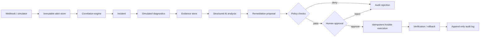

# NetOps Autopilot

NetOps Autopilot is an open-source, AI-assisted network incident investigation and remediation platform. It receives alerts, groups related events, gathers diagnostic evidence, produces uncertainty-aware root-cause hypotheses, and proposes safe remediation. Any change to a network remains behind deterministic policy checks and explicit human approval.

The project is intentionally a modular monolith first. The goal is a finished, measurable system—not a collection of fashionable components.

## Current vertical slice

The first working slice includes:

- `POST /v1/alerts` webhook ingestion with strict validation
- durable SQLite event storage
- idempotent replay handling based on `event_id`
- filtering and retrieval APIs
- structured request logs and a health endpoint
- a synthetic interface-flap alert simulator
- automated API, persistence, and simulator tests

Correlation, diagnostics, AI analysis, and remediation packages are present as explicit module boundaries, but are not falsely presented as implemented.

## Five-minute demo

Prerequisite: Python 3.12+ and [uv](https://docs.astral.sh/uv/).

```bash
uv sync --extra dev
uv run uvicorn netops_autopilot.api:app --reload
```

In another terminal:

```bash
uv run netops-simulator --count 25 --duplicate-every 5
curl http://127.0.0.1:8000/v1/alerts
curl http://127.0.0.1:8000/v1/metrics
```

Run the quality checks:

```bash
uv run ruff check .
uv run pytest --cov
```

## Target incident lifecycle



The AI is an analyst, not an autonomous network operator. It must cite collected evidence, express uncertainty, and never bypass policy or approval controls.

## Repository map

```text
docs/                    Project brief, architecture, roadmap, decisions
src/netops_autopilot/
  ingestion/             API schemas and event persistence
  correlation/           Alert-to-incident grouping (month 2)
  investigation/         Simulated diagnostics and evidence (month 3)
  ai_analysis/           Structured hypotheses (month 4)
  remediation/           Policy, approval, execution (month 5)
  simulator/             Synthetic alert generation
ansible/                 Future safe diagnostic/remediation playbooks
infrastructure/          Future reproducible deployment definitions
tests/                   Unit and API tests
examples/                Safe synthetic payloads
scripts/                 Benchmark tooling
```

See [the project brief](docs/project-brief.md), [architecture](docs/architecture.md), and [six-month roadmap](docs/roadmap.md).

## Data and ethics

Use only synthetic, public, or explicitly authorized data and code. Do not copy proprietary employer configurations, incidents, playbooks, topology, credentials, customer data, or internal implementation details into this repository.

## License

MIT

