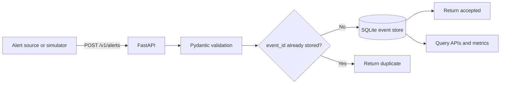
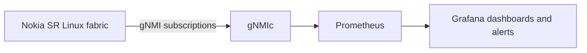
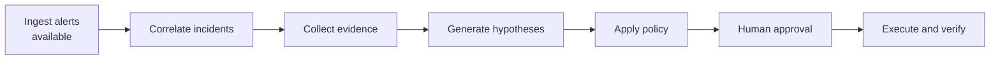

# NetOps Autopilot

NetOps Autopilot is an evidence-first network incident investigation and remediation platform. It accepts network alerts, stores each event once, and exposes the data through an API. Future increments will correlate alerts into incidents, collect diagnostic evidence, generate evidence-backed hypotheses, and execute only policy-approved, human-approved remediation.

The current release is a working alert-ingestion slice with a synthetic alert simulator. It is safe to run locally and does not make changes to network devices.

## What works today

- Receive and validate alerts through `POST /v1/alerts`.
- Store alerts durably in [SQLite](https://docs.python.org/3/library/sqlite3.html).
- Treat repeated `event_id` values as duplicates instead of storing them twice.
- Retrieve and filter stored alerts through the API.
- Report health and basic ingestion metrics.
- Generate a reproducible interface-flap scenario with the included simulator.
- Exercise the API and persistence behavior with automated tests.
- Run a separate [Containerlab](https://containerlab.dev/) network and telemetry lab built around Nokia SR Linux, gNMIc, Prometheus, and Grafana.

Correlation, investigation, AI analysis, approval, and remediation packages currently define boundaries for future work; they are not implemented yet.

## How alert ingestion works



1. An alert source sends JSON to `POST /v1/alerts`.
2. [FastAPI](https://fastapi.tiangolo.com/) receives the request and [Pydantic](https://docs.pydantic.dev/latest/) validates its fields. Unknown fields and invalid values are rejected.
3. The service writes the original alert to SQLite. `event_id` is the primary key, so replaying an alert is safe and idempotent.
4. A newly stored alert returns HTTP `202` with `status: "accepted"`. A replay returns HTTP `200` with `status: "duplicate"` and the previously stored record.
5. Users can retrieve alerts by ID, filter by device or event type, and inspect aggregate severity counts.

Every response includes an `x-request-id` header. Requests are also written as structured logs with their method, path, status, and duration.

## Quick start

### Requirements

- [Python 3.12 or newer](https://www.python.org/downloads/)
- [uv](https://docs.astral.sh/uv/) for dependency and environment management

Install the project dependencies:

```bash
uv sync --extra dev
```

Start the API:

```bash
uv run uvicorn netops_autopilot.api:app --reload
```

The service is now available at <http://127.0.0.1:8000>. Open the interactive API documentation at <http://127.0.0.1:8000/docs>.

In another terminal, send 25 synthetic alerts and replay every fifth event:

```bash
uv run netops-simulator --count 25 --duplicate-every 5
```

The summary should report 20 accepted alerts, 5 duplicates, and no failures:

```json
{"submitted": 25, "accepted": 20, "duplicates": 5, "failed": 0}
```

Inspect the result:

```bash
curl http://127.0.0.1:8000/v1/alerts
curl http://127.0.0.1:8000/v1/metrics
```

The default database is created at `var/netops-autopilot.db`.

## Send an alert manually

An example payload is available at [`examples/interface-flap-alert.json`](examples/interface-flap-alert.json).

```bash
curl --request POST http://127.0.0.1:8000/v1/alerts \
  --header 'content-type: application/json' \
  --data @examples/interface-flap-alert.json
```

An alert contains:

| Field | Meaning |
|---|---|
| `event_id` | Stable identifier used for replay protection |
| `source` | System that produced the alert |
| `device` | Affected network device |
| `interface` | Optional affected interface |
| `event_type` | Machine-readable event category |
| `severity` | `info`, `warning`, or `critical` |
| `observed_at` | Timezone-aware time at which the event occurred |
| `message` | Human-readable description |
| `attributes` | Source-specific structured details |

## API reference

| Method | Path | Purpose |
|---|---|---|
| `GET` | `/health` | Verify that the service and event store are available |
| `POST` | `/v1/alerts` | Validate and ingest an alert |
| `GET` | `/v1/alerts` | List alerts; optionally filter with `device` or `event_type` |
| `GET` | `/v1/alerts/{event_id}` | Retrieve one alert |
| `GET` | `/v1/metrics` | Return stored-event and severity counts |

List only interface-flap alerts for one device:

```bash
curl 'http://127.0.0.1:8000/v1/alerts?device=router-edge-01&event_type=interface_flap&limit=10'
```

## Configuration

| Environment variable | Default | Purpose |
|---|---|---|
| `NETOPS_DATABASE_PATH` | `var/netops-autopilot.db` | SQLite database location |
| `NETOPS_LOG_LEVEL` | `INFO` | Application log level |

For example:

```bash
NETOPS_DATABASE_PATH=/tmp/netops-demo.db \
NETOPS_LOG_LEVEL=DEBUG \
uv run uvicorn netops_autopilot.api:app
```

## Network telemetry lab

The repository includes a separate lab under [`srl-telemetry-lab-main/`](srl-telemetry-lab-main/README.md). [Containerlab](https://containerlab.dev/) reads `st.clab.yml` and creates a small [Nokia SR Linux](https://learn.srlinux.dev/) leaf-and-spine fabric plus its telemetry services.



The lab uses:

- [Containerlab](https://containerlab.dev/) to create and connect the container-based network topology.
- [Nokia SR Linux](https://learn.srlinux.dev/) as the network operating system.
- [gNMIc](https://gnmic.openconfig.net/) to subscribe to streaming telemetry.
- [Prometheus](https://prometheus.io/docs/introduction/overview/) to store time-series metrics.
- [Grafana](https://grafana.com/docs/grafana/latest/) to visualize telemetry and evaluate alert rules.

With Docker and Containerlab installed, deploy the lab from its directory:

```bash
cd srl-telemetry-lab-main
containerlab deploy --reconfigure
```

Grafana is then available at <http://localhost:3000> and Prometheus at <http://localhost:9090/graph>. Follow the [telemetry lab guide](srl-telemetry-lab-main/README.md) for topology access, traffic generation, dashboards, and the interface-down alert demonstration.

Destroy the lab when finished:

```bash
containerlab destroy --cleanup
```

The telemetry lab and the NetOps Autopilot ingestion API are not connected automatically yet. The lab currently provides a realistic environment for later alert-webhook and diagnostic integration.

## Target lifecycle

The project is being delivered one demonstrable vertical slice at a time:



AI output will be treated as untrusted analysis. It may propose and explain, but deterministic policy and an explicit human approval must control every network change.

See the [project brief](docs/project-brief.md), [architecture](docs/architecture.md), [roadmap](docs/roadmap.md), and [architecture decisions](docs/decisions/) for design and delivery details.

## Testing and quality checks

Run the same lint and test commands used by [GitHub Actions](https://docs.github.com/en/actions):

```bash
uv run ruff check .
uv run pytest --cov --cov-report=term-missing
```

The project uses [pytest](https://docs.pytest.org/en/stable/) for tests, [coverage.py](https://coverage.readthedocs.io/) for branch coverage, and [Ruff](https://docs.astral.sh/ruff/) for linting. The configured minimum coverage is 80%.

To measure a local sequential ingestion baseline while the API is running:

```bash
uv run python scripts/benchmark_ingestion.py --count 1000
```

Benchmark results should be recorded with their environment and method under [`docs/benchmarks/`](docs/benchmarks/); do not compare unrecorded or incompatible runs.

## Technology stack

| Technology | Role in this project |
|---|---|
| [Python](https://www.python.org/) | Application and simulator runtime |
| [FastAPI](https://fastapi.tiangolo.com/) | HTTP API and interactive OpenAPI documentation |
| [Pydantic](https://docs.pydantic.dev/latest/) | Alert schema validation and serialization |
| [Uvicorn](https://www.uvicorn.org/) | Local ASGI server |
| [SQLite](https://www.sqlite.org/docs.html) | Durable local alert storage |
| [uv](https://docs.astral.sh/uv/) | Python versions, dependencies, lockfile, and commands |
| [pytest](https://docs.pytest.org/en/stable/) | Automated tests |
| [Ruff](https://docs.astral.sh/ruff/) | Python linting |
| [GitHub Actions](https://docs.github.com/en/actions) | Continuous integration |
| [Containerlab](https://containerlab.dev/) | Container-based network lab orchestration |
| [Nokia SR Linux](https://learn.srlinux.dev/) | Lab network operating system |
| [gNMIc](https://gnmic.openconfig.net/) | Streaming telemetry collector |
| [Prometheus](https://prometheus.io/docs/introduction/overview/) | Metrics storage and querying |
| [Grafana](https://grafana.com/docs/grafana/latest/) | Telemetry dashboards and alerting |

## Data and safety

Use only synthetic, public, or explicitly authorized data and infrastructure. Do not add proprietary configurations, incidents, credentials, customer data, or employer-owned implementation details to this repository.

The included simulator produces synthetic data. The current application does not execute commands or configuration changes on network devices.

## License

This project is licensed under the [MIT License](LICENSE).
